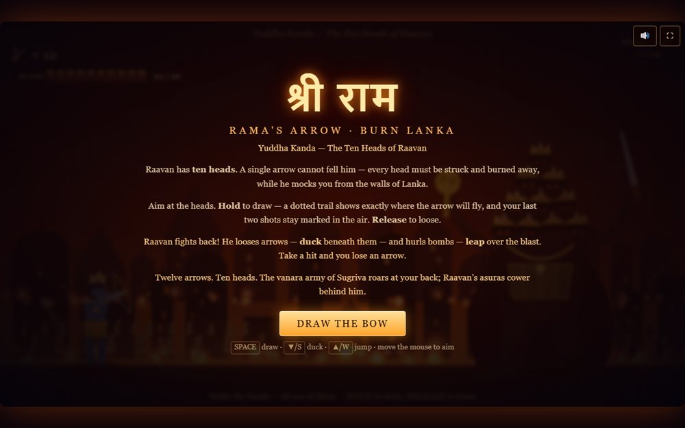

# Shri Ram's Arrow - Burn Lanka

A Ramayana-themed archery game: draw the bow, aim true, and set Lanka alight.

**[Open the live site](https://ajeet-iitk.github.io/Raavan1/)**

## What it does

An archery game retelling the burning of Lanka. Draw the bow, pick your angle, and loose the arrow - the scene is rendered on canvas, with the flight and impact sounds generated through the Web Audio API.

## Features

- Canvas scene with a `requestAnimationFrame` loop
- Aim and power driven by mouse or keyboard
- Synthesised sound effects via `AudioContext`
- Single file game, no dependencies

## Run locally

Open `index.html`, or play the hosted build:

<https://ajeet-iitk.github.io/Raavan1/>

## Files

| File | Purpose |
| --- | --- |
| `index.html` | Landing page |
| `ram-arrow-game.html` | The game |

---

Part of [my collection of small projects](https://github.com/Ajeet-iitk).
